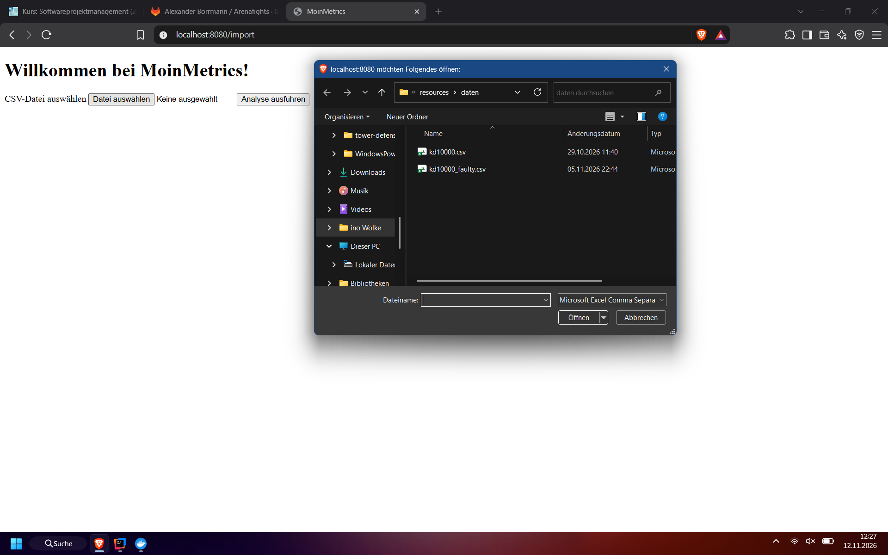
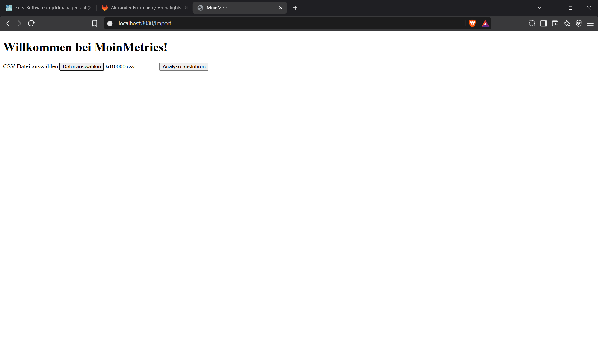
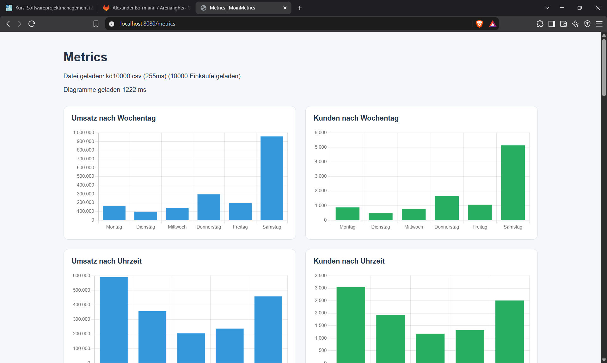

# Aufgabenblatt 4

Hier wird der Zwischenstand des Projekts vorgstellt. Es werden für konkrete Teilaktivitäten der geschätze Aufwand mit 
dem tatsächlichem verglichen. Sowie ein Druchschnitt des Produkts gezeigt. 

## Aufgabe 1 - Aufwanderfassung

    Stellen Sie für mindestens 3 Teilaktivitäten bzw. Stories den geschätzten Aufwand dem bis
    jetzt tatsächlich benötigten Aufwand gegenüber. Geben Sie auch an, welcher Anteil einer
    Teilaktivität bereits realisiert wurde und wie viel Zeit Sie zu diesem Zeitpunkt (geschätzt)
    noch investieren müssen.
    Zeigen Sie diese Information in einer Tabelle, die die absoluten sowie die prozentualen
    Differenzen zu den Planwerten zeigt. Begründen Sie die eventuellen Abweichungen.

## Aufgabe 2 - Prototyp
    
    Stellen Sie einen vertikalen Prototyp (Durchstich) Ihrer geplanten Webseite vor. Dieser muss
    *mindestens* die Funktionen „Upload“, „Analyse ausführen“ und „Analyseergebnis auf der
    Webseite ausgeben“ beinhalten. Fügen Sie mindestens von diesen drei Funktionen einen
    Screenshot in das abzugebende Dokument ein.

