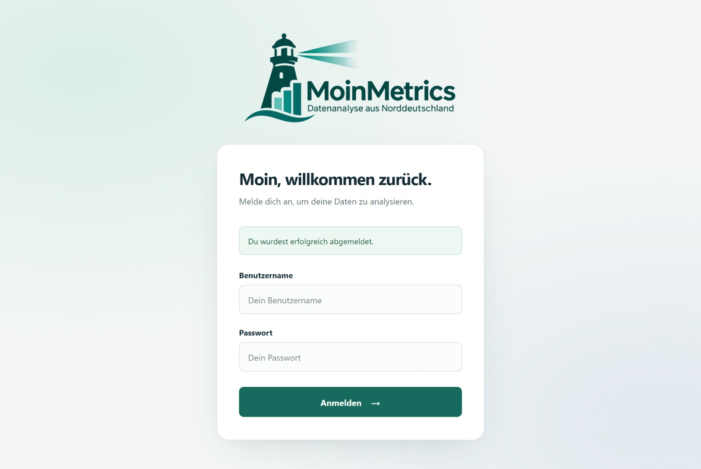
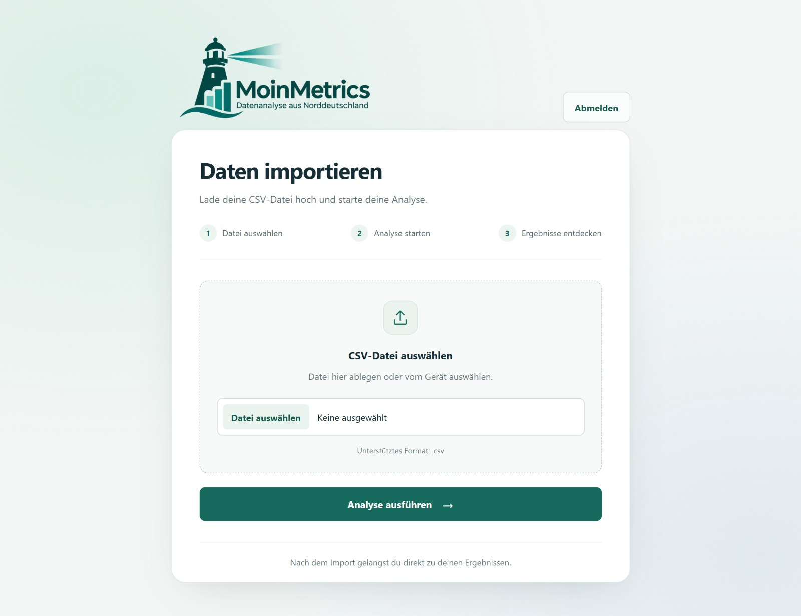
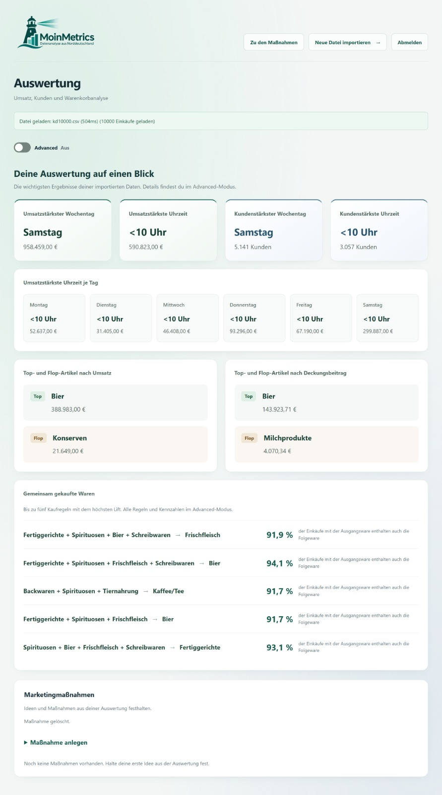
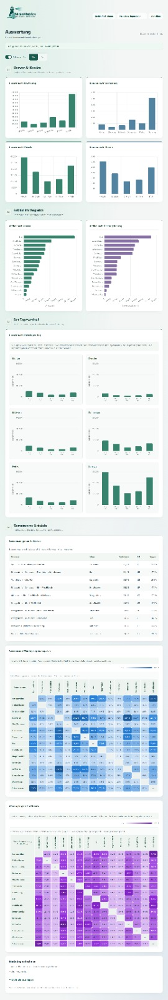

# Aufgabenblatt 4

Hier wird der Zwischenstand des Projekts vorgstellt. Es werden für konkrete Teilaktivitäten der geschätze Aufwand mit
dem tatsächlichem verglichen. Sowie ein Druchschnitt des Produkts gezeigt.

## Aufgabe 1 - Aufwanderfassung

    Stellen Sie für mindestens 3 Teilaktivitäten bzw. Stories den geschätzten Aufwand dem bis
    jetzt tatsächlich benötigten Aufwand gegenüber. Geben Sie auch an, welcher Anteil einer
    Teilaktivität bereits realisiert wurde und wie viel Zeit Sie zu diesem Zeitpunkt (geschätzt)
    noch investieren müssen.
    Zeigen Sie diese Information in einer Tabelle, die die absoluten sowie die prozentualen
    Differenzen zu den Planwerten zeigt. Begründen Sie die eventuellen Abweichungen.

### Aufwandstabelle

Die Planaufwände und Bezeichnungen sind aus den Arbeitspaketen von Blatt 3 übernommen (Personenstunden).

| Teilaktivität / Story      | Planaufwand | Bisher tatsächlich aufgewendet | Realisiert (%) | Geschätzter Restaufwand | Prognose Gesamtaufwand (Ist + Rest) | Abweichung bisher absolut (Ist − Plan) | Abweichung bisher (%) | Prognoseabweichung (%) | Begründung der Abweichung                                                                                                 |
|----------------------------|------------:|-------------------------------:|---------------:|------------------------:|------------------------------------:|---------------------------------------:|----------------------:|-----------------------:|---------------------------------------------------------------------------------------------------------------------------|
| AP 4 – CSV-Import          |          22 |                           15 h |          100 % |                     0 h |                                15 h |                               ca. −7 h |               −31,8 % |                −31,8 % | Grundvalidierung vorhanden; Schätzung ist von komplizierteren analyse ausgegangen                                         |
| AP 5 – Web / Passwort      |          22 |                            8 h |          100 % |                     0 h |                                 8 h |                                  −14 h |               −63,6 % |                −63,6 % | Umsetzung dur Spring deutlich leichter als bei der Schätzung angenommen                                                   |
| AP 10 – Grafische Ausgaben |          12 |                       ca. 12 h |          100 % |                     0 h |                                12 h |                                    0 h |               ca. 0 % |                ca. 0 % | Umfangreiche Diagramme, Übersichten und Heatmaps sind umgesetzt; Vergleiche sind aber ähnlich, daher kein erhöter Aufwand |

## Aufgabe 2 - Prototyp

    Stellen Sie einen vertikalen Prototyp (Durchstich) Ihrer geplanten Webseite vor. Dieser muss
    *mindestens* die Funktionen „Upload“, „Analyse ausführen“ und „Analyseergebnis auf der
    Webseite ausgeben“ beinhalten. Fügen Sie mindestens von diesen drei Funktionen einen
    Screenshot in das abzugebende Dokument ein.

### Vertikaler Prototyp

Der Prototyp zeigt den durchgängigen Ablauf der Warenkorbanalyse. Nach der Anmeldung gelangt die
nutzende Person zum CSV-Import. Dort kann sie eine Datei auswählen oder per Drag-and-drop ablegen
und anschließend die Analyse starten. Beim Import prüft die Anwendung unter anderem Dateityp,
Dateiinhalt, erwartete Spalten und Datentypen. Nach erfolgreichem Einlesen werden die Kennzahlen
berechnet und die Ergebnisseite geöffnet.

Die Ergebnisseite fasst die wichtigsten Kennzahlen zunächst in einer Übersicht zusammen. Dazu zählen
umsatz- und kundenstarke Wochentage und Uhrzeiten, Top- und Flop-Artikel sowie häufig gemeinsam
gekaufte Waren. In der erweiterten Ansicht werden die Auswertungen zusätzlich als Diagramme und
Heatmaps dargestellt. So führt der Prototyp vom geschützten Zugang über Upload und Analyse bis zur
Ergebnisdarstellung auf der Webseite.

*Abbildung 1 zeigt den Login-Bereich. Abbildung 2 zeigt die Dateiauswahl und den Start der Analyse.*

*Abbildung 3 zeigt die kompakte Ergebnisübersicht. Abbildung 4 zeigt die erweiterten grafischen Auswertungen.*

